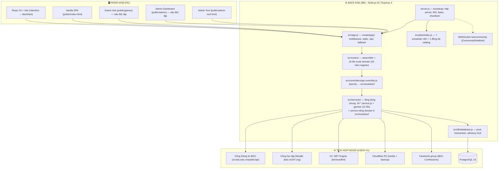

# 🧭 BẢN ĐỒ KIẾN TRÚC DỰ ÁN (PROJECT ARCHITECTURE & CODEBASE GUIDE)

> **Tài liệu phân định ranh giới Front-End (FE) và Back-End (BE)**, giải thích chi tiết cấu trúc thư mục, luồng dữ liệu và cách các thành phần trong hệ thống phối hợp với nhau.
>
> Bản đồ này mô tả **đúng cấu trúc hiện tại của repo**. Nếu cần hiểu vì sao cấu trúc phải giữ nguyên khi sửa, xem thêm [`docs/architecture.md`](docs/architecture.md).

---

## 📌 1. TỔNG QUAN HỆ THỐNG

Toàn bộ workspace hiện tại bao gồm 3 phân hệ chính:
1. **`bdu-tu-hoc/` (Dự án chính)**: Web App Full-stack (**Node.js 22 + Express 4** ở backend, **React 19 + Vite** ở frontend sinh viên, **Vanilla JS/HTML/CSS** ở các site legacy, **PostgreSQL 16** làm kho dữ liệu). Đây là nơi chứa toàn bộ ứng dụng web đang vận hành cho sinh viên.
2. **`dinh dang word/` (Engine C# .NET)**: Mã nguồn C# xử lý sâu vào file `.docx` (OpenXML) theo đúng chuẩn tiểu luận & đồ án tốt nghiệp BDU. Engine này được biên dịch thành binary CLI đặt tại `bdu-tu-hoc/bin/wordfmt/` (gồm `wordfmt.exe` cho Windows và `wordfmt.dll` cho runtime .NET) để Backend gọi bằng `execFile('dotnet', ...)` khi người dùng upload file word. Dockerfile đóng gói `mcr.microsoft.com/dotnet/runtime:10.0` làm base image runtime.
3. **`auto-khao-sat/` (Tool Python)**: Phiên bản desktop GUI chạy bằng Python hỗ trợ auto đánh giá khảo sát giảng viên (bản tiền thân / độc lập).

---

## 🏗️ 2. SƠ ĐỒ KIẾN TRÚC TỔNG THỂ

---

## 🎨 3. PHẦN FRONT-END (FE) — CLIENT-SIDE

Có **hai lớp giao diện cùng tồn tại** trong giai đoạn chuyển đổi: frontend React mới là lớp chính, `public/` là lớp legacy được giữ làm fallback.

### 3.1. Lớp chính: React 19 + Vite (`client/`)

> **Vị trí**: `client/src/` → build ra `dist/client/`, được `src/app.js` phục vụ ở `/app-assets`.

| Đường dẫn | Vai trò | Chức năng cụ thể |
| :--- | :--- | :--- |
| **`client/src/main.jsx`** | Entrypoint React | Mount `App`, nạp CSS global, kích hoạt React Query. |
| **`client/src/app/`** | Khung ứng dụng | `App.jsx` (root layout), `routes.jsx` (URL canonical), `AppErrorBoundary.jsx`, `UpdateBanner.jsx`, `useBuildUpdate.js` (phát hiện bản mới qua `/api/version`), `providers.jsx`, `navigation.js`, `chunk-recovery.js` (tự reload 1 lần khi chunk cũ 404). |
| **`client/src/features/`** | 15 màn hình nghiệp vụ | Mỗi thư mục là một route: `auth`, `gpa`, `info`, `schedule`, `leaderboard`, `enrollment`, `learning`, `wordfmt`, `survey`, `english`, `vocab`, `grammar`, `clubs`, `confession`. |
| **`client/src/components/`** | Component tái sử dụng | Khung dùng chung: card, modal, skeleton, table điểm, terminal log. |
| **`client/src/layouts/`** | Bố cục | Sidebar học tập, khối TIỆN ÍCH, header. |
| **`client/src/api/`** | Lớp gọi API | Wrapper `fetch` cho toàn bộ endpoint `/api/*` của React. |
| **`client/src/services/`** | Tiện ích phía client | WebSocket client, định dạng ngày/điểm, quản lý state cục bộ. |
| **`client/src/styles/`** | Design system | CSS tokens, theme sáng/tối (dùng chung key `bdu_theme` với Game Hub). |

> ⚠️ **Ngoại lệ đã biết**: `client/src/features/grammar/grammar-lib.js` import ngược vào `src/utils/grammar-answers.js` để dùng chung logic chấm đáp án với server. Vì vậy `Dockerfile` phải `COPY src` trước khi `npm run build:client`. `src/utils/` **không được di chuyển**.

### 3.2. Lớp legacy: Vanilla SPA (`public/`)

> **Vị trí**: `public/`. Chỉ được phục vụ làm **fallback** khi `dist/client/index.html` chưa tồn tại, và làm nguồn tài nguyên dùng chung.

| Đường dẫn | Vai trò | Chức năng cụ thể |
| :--- | :--- | :--- |
| **`public/index.html`** | Khung giao diện legacy (fallback) | Toàn bộ view: Đăng nhập, Dashboard, Bảng điểm, TKB, Xếp hạng, Kho tài liệu, Modal công cụ. `src/app.js` chỉ gửi file này khi **không có** bản build React. |
| **`public/admin-tool.html`** | Giao diện quản trị (độc lập) | Bảng điều khiển riêng cho admin: đồng bộ dữ liệu, kiểm tra trạng thái, tra cứu/gỡ ảnh vi phạm. Mount ở `/admin-tool`. |
| **`public/admin/`** | Admin Dashboard (site độc lập) | Site static riêng (`index.html`, `admin.css`, `admin.js`, `chart.min.js`) cho traffic & audit log. Mount ở `/admin`, header `no-store`. |
| **`public/games/`** | Game Hub (site độc lập) | Site static riêng cho game online: `index.html`, `styles/`, `js/` (`api.js`, `identity.js`, `main.js`, `realtime.js`, `session.js`, `sound.js`, `ui.js`, `components/header.js`, `games/` 7 game, `views/game-page.js`, `views/home.js`, `views/room.js`). Mount ở `/games`, mọi deep link fallback về `index.html`. |
| **`public/css/style.css`** | CSS Design System | Giao diện người dùng: dark theme, card, bảng điểm responsive, modal, button. |
| **`public/css/showcase.css`** | CSS hiệu ứng nâng cao | Parallax, pointer spotlight, container queries, animated counter. Tách riêng để không trộn hiệu ứng với nghiệp vụ. |
| **`public/css/admin-tool.css`** | CSS trang quản trị | Bảng tra cứu, form upload, log viewer. |
| **`public/js/app.js`** | Nhạc trưởng FE (legacy) | Lắng nghe sự kiện, quản lý trạng thái sinh viên, chuyển tab, render bảng điểm/TKB. |
| **`public/js/api.js`** | Cầu nối gọi Backend | Đóng gói các hàm `fetch()`: `/api/login`, `/api/scores`, `/api/schedule`, ... |
| **`public/js/interactions.js`** | Vi tương tác UX | `Ctrl/Cmd + K` mở thanh tìm kiếm, âm thanh, hiệu ứng chuyển động. |
| **`public/js/admin-tool.js`** | Logic trang quản trị | Gọi API quản trị, render bảng dữ liệu. |
| **`public/assets/`** | Tài nguyên media | `frames/`, `images/`, `title-tags/`: khung avatar, danh hiệu, logo trường. |

> Lưu ý: các thư mục `public/js/features/` và `public/js/core/` **không còn tồn tại** — chúng đã được thay bằng `client/src/features/`.

---

## ⚙️ 4. PHẦN BACK-END (BE) — SERVER-SIDE

> **Vị trí**: `server.js`, `src/`, `scripts/`, `migrations/`, `bin/`

Back-End chạy trên nền tảng **Node.js 22 + Express 4**, đóng vai trò làm trung gian bảo mật (Proxy / Gateway) giữa trình duyệt sinh viên với Cổng thông tin BDU, hệ thống Moodle, Database PostgreSQL, Cloudflare R2 và Engine xử lý Word.

### 4.1. Tầng bootstrap

| Đường dẫn | Vai trò | Chức năng cụ thể |
| :--- | :--- | :--- |
| **`server.js`** | Điểm khởi chạy (Entry) | `npm start` chạy file này. Gọi `createApp()`, dựng `http.Server`, gắn `CommunityRealtime.attach(server)`, start `EntertainmentGameService`, `server.listen(PORT)`, gọi `startJobs()`. Xử lý `SIGTERM`/`SIGINT`: `stopJobs()` → dừng FB import → đóng realtime → `TrafficService.flush()` → `closeDatabase()` → exit 0. |
| **`src/app.js`** | Cấu hình Express App | `createApp()` khai báo middleware (json/urlencoded 10MB, `attachRequestContext`, `TrafficService.middleware()`), các static mount chuyên biệt (`/media/r2/*` stream từ R2, `/media/fb-import`, `/app-assets` + asset history, `/games`, `/admin`, `/admin-tool`), static `public/` chung, `app.use('/api', apiRoutes)`, fallback SPA (ưu tiên `dist/client/index.html`, không có thì `public/index.html`), timer dọn file tạm mỗi 15 phút, và global error handler (413 cho `LIMIT_FILE_SIZE`). |

### 4.2. Tầng định tuyến & điều khiển

| Đường dẫn | Vai trò | Chức năng cụ thể |
| :--- | :--- | :--- |
| **`src/routes/api.routes.js`** | Assembler | **Không chứa định nghĩa route.** Tạo 1 `express.Router()` rồi gọi lần lượt 20 hàm `register*Routes(router)` theo đúng thứ tự dòng của file gốc. Thứ tự này **là hành vi routing**. |
| **`src/routes/<domain>.routes.js`** | 16 file route theo domain | Mỗi file export hàm `register*Routes(router, deps = {})`. `identity.routes.js` có 4 hàm, `notifications.routes.js` có 2 hàm — vì các domain bị xen kẽ trong file gốc. |
| **`src/routes/_shared/http-deps.js`** | Dependency HTTP dùng chung | Export `ApiController` (barrel), `AdminDashboardController`, `WordFmtService`, `BduIdentityService`, 3 config `multer` (`upload`, `avatarUpload`, `mediaUpload`) và middleware `requireVerifiedMssv`. Tách riêng để mọi file route dùng **chung một instance** của multer và một instance `requireVerifiedMssv`. |
| **`src/controllers/api.controller.js`** | Barrel gom controller | **Chỉ re-export, không chứa logic.** Export 17 `XxxController` từ `src/modules/<domain>/` và gom vào object `ApiController` để route layer gọi `ApiController.<method>`. Tổng cộng **136 method** trong 17 file controller domain (kiểm bằng `node scripts/verify-controller-split.mjs`). |
| **`src/modules/<domain>/`** | 17 controller domain + service riêng domain | `auth`, `academics`, `identity`, `media`, `meta`, `learning`, `games`, `wordfmt`, `survey`, `training`, `english`, `community`, `notifications`, `broadcast`, `clubs`, `vocab`, `grammar` — cộng thêm `src/modules/admin/admin-dashboard.controller.js` tách riêng ở bước đầu tiên (không nằm trong `ApiController`). Từ `ac2307f`, mỗi `src/modules/<domain>/` còn chứa service **riêng của domain** (12 service đơn-domain đã dời về đây, ví dụ `src/modules/community/mention.service.js`); service **dùng chung** vẫn ở `src/services/`. |
| **`src/modules/_shared/`** | Helper thuần | `bearer-token.js` (gộp 4 bản sao trùng lặp, có `.trim()`), `safe-api-error.js` (lọc message lỗi trước khi trả client). Cả hai **không import gì** nên không tạo phụ thuộc vòng. |

### 4.3. Tầng nghiệp vụ & dữ liệu

| Đường dẫn | Vai trò | Chức năng cụ thể |
| :--- | :--- | :--- |
| **`src/jobs/index.js`** | Vòng đời job nền | `startJobs()` bật 7 scheduler (`RankingSchedulerService` — lịch 03:00 chạy **ingest kho ODP rồi mới tới ranking**, `ReminderSchedulerService`, `OutboxMailerService`, `TrafficService`, `FacebookImportService`, `AssetHistoryService`, `MediaCleanupService`) + `IdentityAdminService.syncCatalogFromJson()`. `stopJobs()` dừng chúng và thêm `EntertainmentGameService.stop()`. |
| **`src/services/`** | Tầng service dùng chung | **48 file**: 37 `*.service.js` ở gốc (gồm `ttcds.service.js`, `ttcds-student.service.js`, `odp-sync.service.js`) + thư mục `games/` (11 file: `index.js`, `shared.js` và 9 bộ luật `backgammon`, `battleship`, `caro`, `checkers`, `chess`, `connect4`, `go`, `tic-tac-toe`, `xiangqi`; site `public/games` hiện chỉ bật 7 game cốt lõi). Service **riêng của domain** đã dời về `src/modules/<domain>/` (12 service, commit `ac2307f`); `src/services/` còn lại là tầng dùng chung/core có chủ đích — xem mục "Hai tầng service" ở [`docs/architecture.md`](docs/architecture.md) §4.1. |
| **`src/db/database.js`** | Truy cập PostgreSQL | `getPool()`, `query()`, `transaction()`, `withAdvisoryLock()`, `getMigrationPool()`, `closeDatabase()`. Test mode bắt buộc `NODE_ENV=test` + `BDU_TEST_MODE=1` + `BDU_TEST_CONFIRM_DESTRUCTIVE=1`, database tên `bdu_test_*`, host trong allowlist. |
| **`src/config/load-env.js`** | Env loader + hàng rào test | Nạp `.env` khi **không** ở test mode (fail-closed: tuyệt đối không fallback sang `.env` production khi `NODE_ENV=test`). Chặn chạy trực tiếp `node tests/test-*.js` (mã lỗi `UNMANAGED_TEST_EXECUTION`). |
| **`src/utils/`** | Hàm dùng chung | `docx-*` (graduation/layout/postprocessor/proposal-preservation/structure), `grammar-answers.js`, `grammar-data.js`, `vocab-pos.js`, `async-queue.js`, `request-context.js`, `request-rate-limit.js`. ⚠️ Thư mục này **không được di chuyển** vì client import ngược. |
| **`src/config/game-titles.js`** | Danh hiệu game | Khai báo danh hiệu Game Hub; đọc song song ở `public/games/js/identity.js`. |

### 4.4. Cơ sở dữ liệu & migration

| Đường dẫn | Vai trò | Chức năng cụ thể |
| :--- | :--- | :--- |
| **`migrations/`** | 61 file `.sql` | Đánh số `001_`…`062_` (thiếu `046` — gap có chủ đích, xem `.sdd/task-5-report.md`). Tên file phải khớp `^\d{3}_[a-z0-9][a-z0-9_-]*\.sql$`. |
| **`scripts/migration-ledger.mjs`** | Ledger + khoá | Bảng `public.schema_migrations` lưu `version`, `filename`, `checksum_sha256`, `applied_at`, `execution_ms`, `applied_by`. Advisory lock `MIGRATION_LOCK_ID = 782341`, `lock_timeout = 30s`, `statement_timeout = 5min`. Từ chối checksum lệch, từ chối thiếu version giữa chừng, và **từ chối replay** nếu DB đã có schema (`students`/`academic_rankings`) mà chưa có ledger — phải baseline thủ công. |

### 4.5. Tích hợp hệ thống bên ngoài (KHÔNG có `src/integrations/`)

| Hệ thống | Nơi xử lý | Chi tiết |
| :--- | :--- | :--- |
| **Cổng thông tin BDU** | `src/services/bdu.service.js`, `bdu-identity.service.js` | `BDU_BASE_URL = https://sv.bdu.edu.vn/public/api`. Crawler/proxy đóng giả trình duyệt, quản lý session cookie, parse JSON/HTML: bảng điểm, TKB theo tuần (`/public/api/sch/w-locdstkbtuanusertheohocky`), lý lịch, khảo sát giảng viên. Tài khoản dịch vụ chỉ đọc qua `CDS_USER`/`CDS_PASSWORD`. |
| **Kho ODP (warehouse học vụ)** | `migrations/059_odp_ingest.sql`, `src/services/odp-sync.service.js` | 8 bảng `odp_sinh_vien/tbhk/bang_diem/diem_danh/thoi_khoa_bieu/ren_luyen/su_kien/mon_hoc` + nhật ký `odp_sync_runs`. `npm run odp:sync` hoặc lịch 03:00 (`RANKING_SYNC_HOUR`) chạy **ingest trước, ranking sau**. Env: `CDS_BASE_URL`, `CDS_USER`/`CDS_PASSWORD`, `ODP_SYNC_TIMEOUT_MS` (mặc định 180000), `ODP_SYNC_MAX_ROWS` (mặc định 600000). Mỗi bảng: fetch trọn rồi `TRUNCATE+INSERT` trong 1 transaction → bảng lỗi **giữ nguyên** dữ liệu cũ. `/admin` tab **"Kho ODP"**: trạng thái lần chạy gần nhất, số dòng mỗi bảng, lỗi (nếu có), nút **"Chạy ngay"** (`GET`/`POST /api/admin/dashboard/odp-sync`). |
| **TTCDS "Sinh viên của tôi"** | `src/services/ttcds-student.service.js`, `src/services/odp-sync.service.js`, `src/modules/ttcds/` | Đọc trực tiếp kho `odp_*` local (migration 059) — **không** còn proxy Dashboard BE. Chi tiết SV (`ho_so/gpa_hoc_ky/bang_diem/diem_danh/diem_danh_mon/thoi_khoa_bieu/ren_luyen/su_kien`) dựng từ kho đó; TKB + sự kiện lọc theo MSSV trong `danh_sach_sv`; `Vắng` không tính vào "có mặt"; `tin_chi` nối từ `odp_mon_hoc` theo tiền tố `ma_nhom`. |
| **Moodle** | `src/services/moodle.service.js`, `src/modules/english/english-exercise.service.js` | `MOODLE_URL = https://bdu.vn247.org`. Đăng nhập, quét quiz theo Course ID, đối chiếu ngân hàng đáp án cục bộ. Mật khẩu Moodle chỉ nằm trong bộ nhớ phiên; câu hỏi **không** gửi sang dịch vụ AI bên ngoài. |
| **WordFmt (.NET)** | `src/services/wordfmt.service.js` | `ROOT_DIR` = `path.resolve(__dirname, '../../')`; gọi `execFile('dotnet', [bin/wordfmt/wordfmt.dll, ...], { cwd: ROOT_DIR })`. |
| **Cloudflare R2** | `media-storage.service.js`, `media-upload.service.js`, `src/modules/media/avatar-override.service.js` | Ảnh/avatar lưu trên R2, **không ghi file runtime xuống máy chủ**. `/media/r2/*` stream object khi chưa có custom domain. |
| **Facebook** | `src/services/facebook-import.service.js` | Facebook đã khai tử Groups API nên dùng Playwright đọc feed nhóm `bdu.confessions`. |
| **Discord** | `src/modules/notifications/discord-oauth.service.js`, `discord-link.service.js`, `scripts/discord-bot.js` | OAuth2 liên kết tài khoản + bot nhắc lịch/tag (service riêng `bdu-notifier-bot`). |

### 4.6. Tiện ích bảo trì

| Đường dẫn | Vai trò | Chức năng cụ thể |
| :--- | :--- | :--- |
| **`scripts/migrate.js`** | Chạy migration | `npm run db:migrate` — dùng ledger + advisory lock. |
| **`scripts/db-dump.js` / `db-restore.js`** | Dump / restore SQL | Tạo cặp `<file>` + `<file>.manifest.json` (SHA-256); restore từ chối file thiếu manifest hoặc checksum lệch. |
| **`scripts/db-backup*.js`** | Hệ thống backup R2 | `db-backup.js`, `db-backup-scheduler.js`, `db-backup-rotate.js`, `db-backup-verify.js`, `db-backup-shared.js`. Xem [`docs/backup-restore-runbook.md`](docs/backup-restore-runbook.md). |
| **`scripts/discord-bot.js`, `discord-broadcast.js`** | Bot Discord | Service riêng `bdu-notifier-bot` để crash không kéo sập web. |
| **`scripts/run-safe-tests.mjs`, `run-explicit-suite.mjs`, `sweep-safe-node-tests.mjs`, `test-manifest.mjs`, `test-environment.mjs`** | Test runner | `npm test` chỉ chạy suite an toàn (không DB/network). Runner chặn direct execution. |
| **`scripts/verify-controller-split.mjs`, `verify-route-order.mjs`** | Script kiểm chứng tách | `verify-controller-split.mjs` đối chiếu tập method; `verify-route-order.mjs` so router stack với bản gốc trong git HEAD. |
| **`scripts/postgres-utils.js`** | Hàng rào an toàn DB | Allowlist host local, chặn URL có query lạ, yêu cầu `BDU_MAINTENANCE_ALLOW_PRODUCTION=1` cho remote. |
| **`scripts/`** | Import / export dữ liệu | `import-vocab.js`, `import-grammar*.js`, `export-*.js`, `fix-vocab-pos.js`, `migrate-avatars-to-r2.js`, `sync-rankings.js`, `odp-sync.js`, `fb-import-*.js`. |

---

## 🔄 5. LUỒNG HOẠT ĐỘNG THỰC TẾ (DATA FLOW WORKFLOW)

### Trường hợp 1: Sinh viên Đăng nhập & Xem Bảng điểm
1. **[FE]**: Sinh viên nhập MSSV và Mật khẩu tại màn hình đăng nhập (`client/src/features/auth`, hoặc `public/index.html` nếu fallback).
2. **[FE]**: `client/src/api/` (hoặc `public/js/api.js` ở lớp legacy) gửi `POST /api/login` lên Back-End.
3. **[BE]**: `src/app.js` → `src/routes/auth.routes.js` (`registerAuthRoutes`) → `ApiController.login` trong `src/modules/auth/auth.controller.js`.
4. **[BE]**: Controller gọi `BduIdentityService`/`BduService` để xác thực với cổng trường `sv.bdu.edu.vn`, hoặc xác minh token opaque đã cache (`BDU_RESTORED_TOKEN_TTL_MS`, mặc định 5 phút).
5. **[BE]**: `AcademicSnapshotService` nạp snapshot điểm gần nhất; nếu chưa có thì gọi `BDU_BASE_URL` để đồng bộ rồi tính GPA/tích luỹ.
6. **[BE]**: `AcademicRankingService` trả bảng xếp hạng theo lớp/khoa/viện/toàn trường. Trả JSON về FE.
7. **[FE]**: `client/src/features/gpa` render bảng điểm, biểu đồ và huy hiệu xếp hạng.

### Trường hợp 2: Chuẩn hóa Word BDU (WordFmt)
1. **[FE]**: Sinh viên kéo thả file `.docx` vào mục WordFmt (`client/src/features/wordfmt`).
2. **[FE]**: Gửi file kèm các tùy chọn bìa qua `POST /api/wordfmt/format` (multer `upload`, giới hạn 30MB, chỉ nhận `.docx`).
3. **[BE]**: `src/routes/wordfmt.routes.js` → `ApiController.formatDocx` trong `src/modules/wordfmt/wordfmt.controller.js`.
4. **[BE]**: `WordFmtService` gọi binary CLI `bin/wordfmt/wordfmt.dll` bằng `execFile('dotnet', args, { cwd: ROOT_DIR })` với các tham số tương ứng.
5. **[C# Engine]**: Đọc OpenXML, chỉnh lề trên 2 cm, trái 3 cm, dưới 2 cm, phải 2 cm, đổi Times New Roman 13, chuẩn hóa Heading H1–H4, tạo mục lục/danh mục tự động, áp dụng profile `tieu_luan.json` hoặc bản đóng quyển, xuất file kết quả.
6. **[BE]**: `AssetHistoryService` giữ chunk bản build cũ; `WordFmtService.cleanOldTempFiles()` chạy mỗi 15 phút dọn file tạm. Trả file đã format về trình duyệt để sinh viên tải xuống.

### Trường hợp 3: Realtime Confession & Game Hub
1. **[FE]**: Client mở WebSocket `/ws/community` rồi gửi `{"type":"auth","token":"..."}`.
2. **[BE]**: `CommunityRealtime.attach(server)` (gọi từ `server.js`) xác thực qua `BduIdentityService`, giới hạn buffer (`WS_MAX_BUFFERED_BYTES`) và timeout auth (`WS_AUTH_TIMEOUT_MS`).
3. **[BE]**: Client vào room `confession` (broadcast bài mới, mention) hoặc `game:<room_code>` (nước đi game).
4. **[BE]**: `EntertainmentGameService` kiểm tra nước đi bằng transaction + row lock + `clientMoveId` idempotency; state gửi về đã che theo ghế.
5. **[BE]**: Client mất kết kết nối → `GAME_DISCONNECT_GRACE_MS` (mặc định 30s) trước khi kết thúc ván.

---

## 🛠️ 6. BẠN NÊN CHỈNH SỬA Ở ĐÂU? (DEVELOPMENT GUIDE)

- **Sửa giao diện React (màu sắc, nút bấm, bố cục)**:
  👉 Sửa trong `client/src/features/<domain>/` và `client/src/styles/`.
- **Sửa logic hiển thị của một màn hình (lọc điểm, popup, bảng)**:
  👉 Sửa component trong `client/src/features/<domain>/` hoặc `client/src/components/`.
- **Sửa giao diện legacy / trang quản trị / Game Hub**:
  👉 `public/index.html` + `public/css/style.css` + `public/js/app.js`; `public/admin-tool.html`; `public/admin/`; `public/games/`.
- **Thêm hoặc đổi một API endpoint**:
  👉 Sửa `src/routes/<domain>.routes.js` (URL) **và** `src/modules/<domain>/<domain>.controller.js` (xử lý). Nếu nghiệp vụ phức tạp, đặt SQL vào `src/modules/<domain>/<domain>-*.service.js` (service riêng domain); service dùng chung nhiều domain vẫn ở `src/services/`.
- **Đổi thuật toán dữ liệu điểm, TKB BDU, Moodle, R2, Facebook, Discord**:
  👉 Sửa trong `src/services/` (`bdu.service.js`, `bdu-identity.service.js`, `moodle.service.js`, `media-*.service.js`, `facebook-import.service.js`, `discord-link.service.js`) hoặc `src/modules/<domain>/` cho phần riêng domain (`english-exercise.service.js`, `discord-oauth.service.js`, …).
- **Đổi quy chuẩn canh lề, font chữ, format bìa Word**:
  👉 Sửa project C# `dinh dang word/src/WordFmt.Core/` rồi build đè binary vào `bdu-tu-hoc/bin/wordfmt/`. Profile mặc định nằm ở `bin/wordfmt/profiles/*.json` và `profiles/`.
- **Thêm một job nền**:
  👉 Thêm service scheduler vào `src/services/`, rồi start/stop trong `src/jobs/index.js`.
- **Đổi schema database**:
  👉 Thêm file `migrations/0NN_<ten>.sql` (version chưa tồn tại, không được sửa file đã apply vì ledger kiểm checksum).
- **Đổi quy trình deploy / backup**:
  👉 Deploy thủ công trên VPS (backup → migrate → restart → healthcheck, xem README mục “Triển khai Production”); backup dùng `scripts/db-backup*.js`, xem [`docs/backup-restore-runbook.md`](docs/backup-restore-runbook.md).

---

## 7. GHI CHÚ VỀ FEATURE JSX (ĐÃ CHỐT)

Bản tài liệu cũ từng so sánh "giữ nguyên Vanilla monolith" với "tách sang JSX/React". **Quyết định đã được thực hiện**: frontend chính thức chuyển sang **React 19 + Vite** trong `client/`, còn `public/` giữ làm fallback và cho các site độc lập (`/games`, `/admin`, `/admin-tool`).

Hợp đồng hành vi, danh sách route canonical và ranh giới legacy/React được chốt ở [`docs/frontend-migration-baseline.md`](docs/frontend-migration-baseline.md); kế hoạch thực hiện ở [`docs/jsx-routing-migration-plan.md`](docs/jsx-routing-migration-plan.md).

---

## 8. TÀI LIỆU LIÊN QUAN

| Tài liệu | Nội dung |
| :--- | :--- |
| [`docs/architecture.md`](docs/architecture.md) | Sơ đồ tầng, bảng 16 domain, **quy tắc bất di bất dịch** khi sửa `src/`, nợ kỹ thuật còn lại. |
| [`docs/backup-restore-runbook.md`](docs/backup-restore-runbook.md) | Runbook backup DB lên R2, retention, restore drill. |
| [`docs/frontend-migration-baseline.md`](docs/frontend-migration-baseline.md) | Baseline hành vi frontend React. |
| [`docs/local-test-services.md`](docs/local-test-services.md) | Dựng dịch vụ test local (PostgreSQL, R2 giả lập). |
| [`docs/wordfmt-*.md`](docs/) | Chuẩn tài liệu WordFmt (tiểu luận, đồ án, cấu trúc). |

---
*Tài liệu được đối chiếu với cấu trúc thật của repo tại commit hiện tại.*
