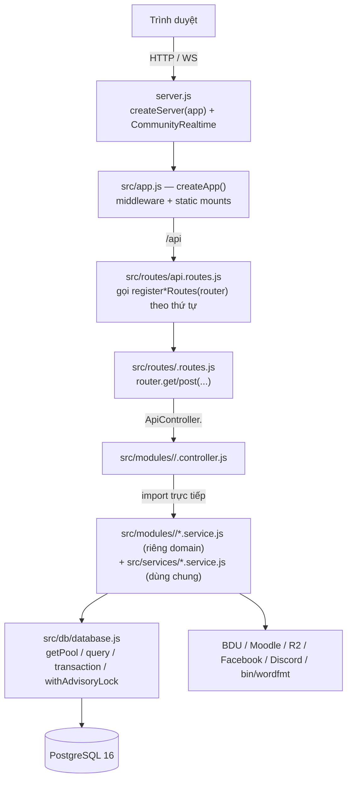

# Kiến trúc Backend — BDU Tự Học

> Tài liệu này mô tả **tầng kiến trúc hiện tại** sau đợt tách cấu trúc (server.js → `src/app.js` + `src/jobs`, `api.routes.js` → 16 file route theo domain / 20 hàm `register*Routes`, `api.controller.js` 2612 dòng → 17 controller domain).
>
> Bản đồ cấu trúc tổng thể cho người mới đọc nằm ở [`../READFORME.md`](../READFORME.md). Tài liệu này tập trung vào **tại sao** cấu trúc phải giữ nguyên.

---

## 1. Luồng xử lý một request



Các điểm cần nhớ:

- `src/app.js` **không** chứa job nền và **không** tạo http server; nó trả về `app` để `server.js` quyết định port và vòng đời tiến trình.
- `server.js` **không** biết route nào tồn tại; nó chỉ gọi `createApp()` rồi `startJobs()`.
- `src/routes/api.routes.js` **không** chứa định nghĩa route, chỉ là assembler.
- `src/controllers/api.controller.js` **không** chứa logic, chỉ là barrel re-export.
- `src/jobs/index.js` là nơi duy nhất start/stop các scheduler nền.

---

## 2. Bảng 17 domain nghiệp vụ

Cột "Controller" là file export object literal; cột "Route" là file chứa hàm `register*Routes`. Cột "Service được controller import" liệt kê các service mà controller đó import (đã đối chiếu trực tiếp từ câu lệnh `import` trong file). Sau refactor hai tầng (`ac2307f`): service **riêng của domain** nằm ở `src/modules/<domain>/` và được ghi kèm đường dẫn; tên trần (không có thư mục) là service **dùng chung** ở `src/services/` — xem mục 4.1.

| Domain | Controller | Route | Service được controller import |
| :--- | :--- | :--- | :--- |
| **auth** | `src/modules/auth/auth.controller.js` (54 dòng) | `src/routes/auth.routes.js` | `bdu.service.js`, `bdu-identity.service.js`, `student.service.js`, `academic-snapshot.service.js`, `schedule-snapshot.service.js`, `notification-prefs.service.js` |
| **academics** | `src/modules/academics/academics.controller.js` (185) | (dùng chung `auth.routes.js`) | `academic-ranking.service.js`, `academic-snapshot.service.js`, `src/modules/academics/achievement.service.js`, `bdu.service.js`, `bdu-identity.service.js`, `learning.service.js`, `ranking-scheduler.service.js`, `schedule-snapshot.service.js` |
| **identity** | `src/modules/identity/identity.controller.js` (352) | `src/routes/identity.routes.js` (4 hàm register) | `identity-presentation.service.js`, `identity-admin.service.js`, `student.service.js`, `permission.service.js`, `bdu.service.js`, `bdu-identity.service.js`, `academic-snapshot.service.js`, `academic-ranking.service.js`, `community-realtime.service.js` |
| **media** | `src/modules/media/media.controller.js` (90) | (nằm trong `identity.routes.js` + `community.routes.js`) | `media-upload.service.js`, `src/modules/media/avatar-override.service.js`, `identity-admin.service.js`, `bdu-identity.service.js`, `community-realtime.service.js` |
| **meta** | `src/modules/meta/meta.controller.js` (44) | `src/routes/meta.routes.js` | `wordfmt.service.js`, `community-realtime.service.js` |
| **learning** | `src/modules/learning/learning.controller.js` (149) | `src/routes/learning.routes.js` | `learning.service.js`, `bdu.service.js`, `bdu-identity.service.js`, `community-realtime.service.js` |
| **games** | `src/modules/games/games.controller.js` (195) | `src/routes/games.routes.js` | `entertainment-game.service.js`, `community-realtime.service.js`, `bdu-identity.service.js` |
| **wordfmt** | `src/modules/wordfmt/wordfmt.controller.js` (130) | `src/routes/wordfmt.routes.js` | `wordfmt.service.js`, `bdu-identity.service.js` |
| **survey** | `src/modules/survey/survey.controller.js` (135) | `src/routes/survey.routes.js` | `src/modules/survey/survey.service.js`, `src/modules/survey/survey-run.service.js`, `bdu-identity.service.js` |
| **training** (thêm ở `c061b4c`) | `src/modules/training/training.controller.js` (106) | `src/routes/training.routes.js` | `src/modules/training/training-score.service.js`, `training-cds-credentials.service.js`, `bdu-identity.service.js` |
| **english** | `src/modules/english/english.controller.js` (149) | `src/routes/english.routes.js` | `src/modules/english/english-exercise.service.js`, `permission.service.js`, `bdu-identity.service.js` |
| **community** | `src/modules/community/community.controller.js` (450) | `src/routes/community.routes.js` | `community.service.js`, `community-realtime.service.js`, `src/modules/community/mention.service.js`, `facebook-import.service.js`, `reminder-digest.service.js`, `bdu-identity.service.js` |
| **notifications** | `src/modules/notifications/notifications.controller.js` (206) | `src/routes/notifications.routes.js` (2 hàm register) | `src/modules/notifications/notification.service.js`, `notification-prefs.service.js`, `discord-link.service.js`, `src/modules/notifications/discord-oauth.service.js`, `schedule-snapshot.service.js`, `bdu-identity.service.js` |
| **broadcast** | `src/modules/broadcast/broadcast.controller.js` (37) | `src/routes/broadcast.routes.js` | `broadcast.service.js` |
| **clubs** | `src/modules/clubs/clubs.controller.js` (289) | `src/routes/clubs.routes.js` | `clan-quiz.service.js`, `clan-role.service.js`, `permission.service.js`, `student.service.js`, `bdu-identity.service.js` |
| **vocab** | `src/modules/vocab/vocab.controller.js` (150) | `src/routes/vocab.routes.js` | `src/modules/vocab/vocab.service.js`, `bdu-identity.service.js` |
| **grammar** | `src/modules/grammar/grammar.controller.js` (128) | `src/routes/grammar.routes.js` | `src/modules/grammar/grammar.service.js`, `bdu-identity.service.js` |
| **admin** (tách riêng) | `src/modules/admin/admin-dashboard.controller.js` (436) | `src/routes/admin.routes.js` | `traffic.service.js`, `system-settings.service.js`, `identity-admin.service.js`, `academic-ranking.service.js`, `ranking-scheduler.service.js`, `bdu.service.js`, `bdu-identity.service.js` |

Hai điểm cần lưu ý về bảng này:

1. **`admin` không nằm trong `ApiController`.** `admin-dashboard.controller.js` được tách ở bước đầu tiên (pilot) nên nó export `AdminDashboardController` riêng, được `src/routes/_shared/http-deps.js` re-export. 136 method của `ApiController` **không** chứa method của admin dashboard.
2. **Không phải domain nào cũng có file route riêng.** Route file chia theo *nhóm route trong file gốc*, controller file chia theo *domain nghiệp vụ*. `academics` dùng chung route với `auth`; `media` dùng chung route với `identity` và `community`. Tên file route không suy ra được từ tên thư mục controller.

### Số liệu kiểm chứng

| Kiểm tra | Lệnh | Kết quả |
| :--- | :--- | :--- |
| Tập method controller khớp | `node scripts/verify-controller-split.mjs` | 136 method trong 17 file controller |
| Thứ tự route khớp bản gốc | `node scripts/verify-route-order.mjs` | Bản gốc là phiên bản nhiều route nhất **nạp được** trong lịch sử; route cũ không được mất/hoán vị |

Hai script trên lấy bản gốc từ **lịch sử git** (không hard-code commit), nên khi có tính năng mới thêm method/route, chúng sẽ báo `SAI LẠCH` cho tới khi phần thêm mới được khai báo tường minh:

- Method mới: thêm tên vào `ADDED_AFTER_SPLIT` trong `scripts/verify-controller-split.mjs`.
- Route mới: thêm `"<METHOD> <path>"` vào `ROUTES_ADDED_AFTER_SPLIT` trong `scripts/verify-route-order.mjs`.

Khai báo như vậy giữ guard còn hiệu lực: **mất** method/route vẫn fail, **hoán vị** route cũ vẫn fail, còn thêm mới thì buộc phải có chủ ý.

---

## 3. Quy tắc bất di bất dịch

Năm quy tắc dưới đây **không được phá vỡ**. Mỗi quy tắc ghi kèm hậu quả cụ thể nếu vi phạm.

### 3.1. Không controller con nào import từ barrel `src/controllers/api.controller.js`

**Quy tắc**: `src/modules/<domain>/<domain>.controller.js` chỉ được import service của chính nó, `_shared/` helper, `src/config/*` và `src/db/database.js`. Tuyệt đối không `import { ApiController } from '../../controllers/api.controller.js'`.

**Vì sao**: `api.controller.js` re-export **tất cả** 17 controller domain. Nếu một controller con import ngược lại barrel thì:
- `auth.controller.js` → `api.controller.js` → `academics.controller.js` → … → `api.controller.js` (vòng).
- Node ESM chịu được phần lớn vòng, nhưng khi vòng đi qua object literal `export const ApiController = { ...A, ...B }` thì thứ tự khởi tạo module trở nên phụ thuộc vào thứ tự import. Method nào được gán vào `ApiController` trước có thể là `undefined` tại thời điểm module route nạp → lỗi kiểu `ApiController.login is not a function` chỉ xuất hiện ở production khi thứ tự import đổi.

**Hiện trạng**: đã kiểm tra — không controller con nào import từ barrel. Lưu ý hướng ngược lại là hợp lệ: `src/routes/_shared/http-deps.js` import barrel là đúng, vì route layer cần gom nhiều domain.

### 3.2. Thứ tự gọi `register*(router)` trong `api.routes.js` là hành vi routing

**Quy tắc**: khối `register*Routes(router)` trong `src/routes/api.routes.js` phải giữ nguyên thứ tự dòng. Đổi thứ tự là **thay đổi API**, không phải refactor.

**Vì sao**: Express khớp route **theo thứ tự đăng ký**, không theo độ dài hay độ cụ thể của pattern. Ba hệ quả cụ thể trong repo này:

1. `router.use('/admin/dashboard', AdminDashboardController.requireAdmin)` trong `src/routes/admin.routes.js` là **prefix-match**, nên nó chặn **mọi** URL bắt đầu bằng `/admin/dashboard`. Vì vậy `router.post('/admin/dashboard/login', …)` phải được đăng ký **trước** nó (dòng 13 trước dòng 14) — đảo hai dòng này thì không ai đăng nhập được vào dashboard. Vì `registerAdminRoutes` nhận `router` dùng chung, thứ tự bên trong hàm cũng là thứ tự runtime; đổi bất kỳ dòng nào trong khối này đều là thay đổi hành vi.
2. Vì các domain bị **xen kẽ** trong file gốc (identity → notification → reminder → identity-admin → facebook-import → broadcast → avatar → admin), chúng được tách thành nhiều hàm register riêng: `identity.routes.js` có 4 hàm (`registerIdentityPortalRoutes`, `registerIdentityAdminRoutes`, `registerFacebookImportRoutes`, `registerIdentityAvatarRoutes`), `notifications.routes.js` có 2 hàm (`registerNotificationRoutes`, `registerReminderRoutes`). Gộp chúng lại thành 1 hàm sẽ **không** tái tạo được thứ tự cũ.
3. File route nhận `router` dùng chung (không tạo `express.Router()` riêng cho từng domain) chính là để giữ thứ tự: nếu mỗi domain là một router riêng rồi `app.use()` lần lượt, Express sẽ ghép lại theo thứ tự `app.use` chứ không phải thứ tự đăng ký route bên trong.

**Cách kiểm chứng**: `node scripts/verify-route-order.mjs` lấy bản gốc từ **lịch sử git** (phiên bản nhiều route nhất còn `import` được), dựng cả hai router rồi kiểm tra danh sách route cũ là **dãy con đúng thứ tự** của danh sách mới. Route cũ không được mất và không được hoán vị; route thêm mới phải khai báo trong `ROUTES_ADDED_AFTER_SPLIT` của script.

### 3.3. Controller có module-level state thì phải có ĐÚNG MỘT URL import

**Quy tắc**: file controller có state ở cấp module (ví dụ `const loginFailures = new Map()` trong `src/modules/admin/admin-dashboard.controller.js`) phải được import từ **một URL duy nhất** trong toàn hệ thống. Tuyệt đối không tạo stub re-export (`export * from './x.controller.js'`) ở nơi khác, và không import file này bằng hai đường dẫn khác nhau (ví dụ vừa `'../../modules/admin/admin-dashboard.controller.js'` vừa `'../modules/admin/admin-dashboard.controller.js'`).

**Vì sao**: ESM cache module theo **URL đã resolve**, không theo đường dẫn dùng để import. Nếu `a/b/c.js` và `b/c.js` cùng trỏ tới một file, chúng là **2 module instance** → 2 object khác nhau. Với `loginFailures` (rate-limit đăng nhập admin), điều đó có nghĩa:
- Người dùng bị khoá sau 5 lần sai ở instance A vẫn được thử lại ở instance B.
- Rate-limit **không bao giờ** chạm ngưỡng → brute-force `ADMIN_DASHBOARD_KEY` không bị chặn.
- Bản đồ state phình vô hạn vì hai instance không thấy entry của nhau.

Nguyên tắc chung: **mọi state phải nằm ở service hoặc DB**, không nằm ở controller. Nếu buộc phải để state ở controller thì controller đó chỉ được import từ một chỗ.

**Hiện trạng**: `loginFailures` là state module-level **duy nhất** còn lại trong toàn bộ `src/modules/`. `src/modules/_shared/bearer-token.js` và `safe-api-error.js` là hàm thuần không có state — chúng có thể import ở bao nhiêu nơi cũng an toàn, và chính vì vậy tách chúng ra `_shared/` là an toàn.

### 3.4. `src/utils/` KHÔNG được di chuyển

**Quy tắc**: giữ nguyên vị trí và cấu trúc thư mục `src/utils/`. Không chuyển vào `src/modules/`, không gộp vào `src/services/`, không đổi tên file.

**Vì sao** — hai ràng buộc độc lập cùng trỏ tới cùng một kết luận:

1. **Client import ngược.** `client/src/features/grammar/grammar-lib.js` (dòng 10) `import { ... } from '../../../../src/utils/grammar-answers.js'` để dùng chung logic chấm đáp án với server. Nếu `src/utils/` biến mất hoặc đổi đường dẫn, **frontend build sẽ fail** trong stage `frontend-build` của `Dockerfile`.
2. **`Dockerfile` `COPY src` cho frontend build.** `Dockerfile:17-19`:
   ```
   # src/utils/grammar-answers.js được client import để dùng chung logic chấm đáp án.
   COPY src ./src
   ```
   Stage `frontend-build` chỉ copy `package*.json`, `client/`, `src/`, `vite.config.js`. Đó là lý do `src/` phải nằm trong build context của frontend dù phần lớn nó là code server.

Hệ quả tương tự: **`src/config/load-env.js`** cũng phải giữ nguyên vì `src/db/database.js`, `scripts/postgres-utils.js` và cả 4 script `db-backup*.js` đều import nó, và nó chứa hàng rào chặn test (`UNMANAGED_TEST_EXECUTION`).

### 3.5. File chứa path theo độ sâu thư mục phải sửa số cấp nếu di chuyển

**Quy tắc**: trước khi `git mv` bất kỳ file nào chứa `path.resolve(__dirname, ...)`, hãy đếm lại số `..` và sửa ngay trong cùng commit.

**Vì sao**: `__dirname` là đường dẫn tuyệt đối của file đang chạy. Di chuyển file xuống sâu thêm 1 cấp mà quên sửa `'../..'` thì `ROOT_DIR` trỏ vào thư mục **không tồn tại** — và biểu hiện là lỗi runtime lúc đọc file (`ENOENT`), thường chỉ xuất hiện khi chạy chứ không phải lúc import.

Ba file đang phụ thuộc điều này:

| File | Dòng | Cụm | Ý nghĩa |
| :--- | :--- | :--- | :--- |
| `src/services/wordfmt.service.js` | 19 | `path.resolve(__dirname, '../../')` | `ROOT_DIR` → repo root; từ đó tính `temp/`, `profiles/`, `bin/wordfmt/wordfmt.dll` và `cwd` cho `execFile('dotnet', …)`. |
| `src/services/facebook-import.service.js` | 26 | `path.resolve(__dirname, '..', '..')` | `ROOT_DIR` → repo root; dùng cho thư mục media/profile Facebook. |
| `src/app.js` | 25 | `path.resolve(__dirname, '..')` | `ROOT_DIR` → repo root; dùng cho `dist/client`, `public/`, `temp/`, `data/fb-import`. |

Biến thể cùng loại khác: `src/config/load-env.js` dùng `path.resolve(process.cwd(), '.env')` — phụ thuộc **cwd**, không phụ thuộc vị trí file. Nếu đổi cwd khi chạy (`docker compose exec`, systemd service) thì `.env` sẽ không được nạp.

### 3.6. Cửa chặn bảo trì theo nhóm đứng sau static và trước router `/api`

**Quy tắc**: `GET /api/status` là **endpoint công khai** để client đọc trạng thái khóa dịch vụ theo nhóm (`{ result:true, data:{ groups } }`, đủ 10 nhóm `lockable`, không kèm `updated_at`/`updated_by`). Middleware `createServiceLockGuard` trong `src/app.js` phải được gắn **sau** mọi mount static và **trước** `app.use('/api', apiRoutes)`.

**Vì sao**:

- **Sau static**: màn hình bảo trì là một phần của trang SPA nằm trong `public/`/`dist/client`; nếu cửa chặn đứng trước `express.static`, `/app-assets` và chính trang bảo trì sẽ bị chặn và người dùng không bao giờ thấy nội dung bảo trì.
- **Trước router `/api`**: để chặn mọi request `/api/*` tại một điểm duy nhất mà **không** phải sửa thứ tự đăng ký route trong `api.routes.js` (thứ tự đó là hành vi routing, xem mục 3.2).

**Khóa theo nhóm, không còn khóa toàn site**: trạng thái nằm trong `system_settings` key `service_lock` dạng `{ groups: { <id>: { locked, title, message } } }` (đủ 10 nhóm `lockable` trong `src/config/feature-groups.js`; `portal` không lockable nên cổng sinh viên/đăng nhập không bao giờ bị khóa). Guard tra nhóm bằng `featureForPath(req.path)` rồi chỉ chặn (`503` + `{ result:false, code:'MAINTENANCE', group, title, message }`) khi nhóm đó `lockable` và đang khóa — quy tắc nhóm này thay cho danh sách miễn trừ cứng trước đây. Nhờ đó `/health`, `/version`, `/status`, toàn bộ `/admin/dashboard/*`, `/login`, `/profile`, `/grades`… tự động cho qua vì chúng không thuộc nhóm `lockable` nào. Hai trường hợp quan trọng nhất vẫn đúng:

- `/health` **không** được chặn vì script deploy dựa vào nó để biết app còn sống; chặn `/health` khi đang khóa sẽ khiến deploy tưởng app chết và tự rollback.
- `/admin/dashboard/login` **không** được chặn vì nếu chặn cả khu quản trị thì sau khi khóa xong không ai đăng nhập lại được để tắt khóa.

**Realtime**: WebSocket `/ws/community` chỉ bị từ chối/đóng khi nhóm `community` khóa; khóa nhóm khác không đụng tới kết nối realtime. Cụ thể, `AdminDashboardController.setServiceLock` chỉ gọi `CommunityRealtime.disconnectAllForMaintenance()` khi body là `{ group:'community', locked:true }`.

**Admin API**: `GET`/`PUT /api/admin/dashboard/service-lock` giữ nguyên route. `GET` trả `{ groups, catalog, updated_at, updated_by }`; `PUT` nhận `{ group, locked, title, message }`, ghi đúng một nhóm qua `ServiceLockService.setGroupStatus`, trả `{ groups, updated_at, updated_by }`.

### 3.7. Endpoint phân tích `/admin/dashboard/insights/*` đọc qua taxonomy chung

**Quy ước**: 5 endpoint `GET /admin/dashboard/insights/features|hours|cohort|quality` và `GET /admin/dashboard/insights/users/:mssv/journey` (đăng ký trong `src/routes/admin.routes.js`, sau `PUT /admin/dashboard/service-lock`) đều qua `TrafficInsightsService` trong `src/modules/admin/traffic-insights.service.js`, chỉ đọc hai bảng sẵn có `traffic_logs` + `students`, không thêm migration.

**Vì sao**:

- **Một taxonomy duy nhất**: mọi phép gom theo tính năng đều qua `featureForPath` trong `src/config/feature-groups.js` (endpoint lạ như đăng nhập/thông báo rơi vào nhóm `other` nhưng vẫn nằm trong tổng); giữ một chỗ tra cứu để server và tab Insights không lệch nhau khi thêm tính năng mới.
- **Một múi giờ duy nhất**: `created_at` lưu UTC nên mọi cột thời gian tính toán đều bọc `(created_at AT TIME ZONE 'Asia/Ho_Chi_Minh')` qua hằng `ANALYTICS_TZ`; quên quy đổi thì heatmap và cohort lệch đúng 7 tiếng.
- **Lỗi 5xx chuỗi cố định**: service để lỗi DB nổi lên, controller đổi thành thông báo cố định để không lộ chi tiết SQL; khi chưa cấu hình DB (`!isDatabaseConfigured()`) service trả cấu trúc rỗng để trang Insights hiện rỗng thay vì 500 trắng.

---

## 4. Quyết định kiến trúc & nợ kỹ thuật còn lại

### 4.1. Hai tầng service có chủ đích: shared `src/services/` + domain-owned `src/modules/<domain>/`

**Trạng thái** (sau commit `ac2307f`): 12 service đơn-domain đã dời về `src/modules/<domain>/`. `src/services/` còn **45 file** (34 `*.service.js` ở gốc + 11 file trong `src/services/games/`) và mang vai trò **tầng dùng chung/core** — sở hữu có chủ đích, không còn là bãi tập kết.

Tiêu chí phân loại (quyết định đã duyệt): dời về domain **chỉ khi** service được đúng **một** domain import, **không** có caller ngoài `src/modules/` (`app.js` / `jobs` / `server.js` / `scripts` / `client`), **và** không bị service tầng dùng chung import lại. Không thoả thì **ở lại** `src/services/`.

**7 service ở lại vì có inbound từ tầng dùng chung** (bằng chứng grep trong commit `ac2307f`):

| Service ở lại `src/services/` | Bị import bởi (inbound) |
| :--- | :--- |
| `system-settings.service.js` | `service-lock.service.js`, `ranking-scheduler.service.js` |
| `clan-role.service.js` | `student.service.js` |
| `clan-quiz.service.js` | `student.service.js` |
| `community.service.js` | `entertainment-game.service.js`, `learning.service.js` |
| `reminder-digest.service.js` | `reminder-scheduler.service.js` |
| `identity-presentation.service.js` | `community-realtime.service.js`, `community.service.js`, `entertainment-game.service.js`, `learning.service.js` |
| `media-upload.service.js` | `community.service.js`, `media-cleanup.service.js` |

**Vì sao hai tầng thay vì "tất cả vào domain"**: kéo 7 service trên vào domain sẽ buộc tầng dùng chung import ngược lên `src/modules/`, hoặc phải nhân bản instance (phá quy tắc 3.3 — hai URL import = hai instance module, state `Map` bị chia đôi âm thầm). Hai tầng giữ đúng **một URL** cho mỗi module mà vẫn cho mỗi domain tự chứa service riêng.

**Ràng buộc đã xử lý khi dời** (mục 3.5): service dời sâu thêm 1 cấp đã sửa `../db/` → `../../db/`, `../config/` → `../../config/`, `../utils/` → `../../utils/`, và `./<shared>.service.js` → `../../services/<shared>.service.js`. Hai ngoại lệ: `survey-run.service.js` giữ nguyên `./survey.service.js` (đi chung cặp vào `src/modules/survey/`); `english-exercise.service.js` dùng `process.cwd()` + env nên không phụ thuộc độ sâu. Không để lại re-export shim ở đường dẫn cũ.

**Guard**: `tests/test-service-domain-paths.js` chốt 3 điều — 12 file nằm ở đúng `src/modules/<domain>/`, 0 tham chiếu đường dẫn cũ `services/<name>` trong `src` / `tests` / `scripts` / `client` / `server.js`, và `src/services/` không import `../modules/`.

**Còn lại (không cần làm ngay)**: `src/services/` vẫn là một mặt phẳng theo tên file, chưa chia thư mục con theo nhóm (`notifications`, `media`, …). Đổi tên tủ không tạo giá trị (YAGNI) cho tới khi có nhu cầu scale thật.

### 4.2. Controller còn gọi SQL trực tiếp

**Trạng thái**: sau khi đếm lại trên cây `src/modules/` hiện tại, chỉ còn **1 method** gọi `query()` trực tiếp từ `src/db/database.js` thay vì qua service: `sendDiscordTest` trong `src/modules/notifications/notifications.controller.js` (`import { query }` ở dòng 14, `await query(...)` ở dòng 192). Không còn chỗ nào chạm `pool` hay `getClient()` trực tiếp trong controller. (`src/modules/admin/admin-dashboard.controller.js` chỉ import `isDatabaseConfigured` để kiểm tra cấu hình, không query.)

**Đánh giá**: đây là **mùi có sẵn** từ trước đợt tách, không phải hệ quả của việc tách file. Tách file **không giải quyết được** vấn đề này — nó chỉ làm vấn đề dễ nhìn thấy hơn.

Cách xử lý đúng: chuyển SQL đó xuống `src/modules/notifications/notification.service.js` hoặc `discord-link.service.js` (cả hai đều đã được controller này import sẵn) kèm bộ test. Việc này độc lập với việc di chuyển service ở mục 4.1, nên làm được ngay mà không cần đợi.

---

## 5. Sổ tra cứu nhanh

| Cần sửa gì? | Mở file nào? |
| :--- | :--- |
| Thêm URL API | `src/routes/<domain>.routes.js` (giữ vị trí trong `api.routes.js`) |
| Sửa xử lý 1 endpoint | `src/modules/<domain>/<domain>.controller.js` |
| Sửa SQL / logic nghiệp vụ của một domain | `src/modules/<domain>/*.service.js` (service riêng domain) hoặc `src/services/<shared>.service.js` (tầng dùng chung — xem mục 4.1) |
| Thêm job nền | `src/services/` (scheduler dùng chung) + `src/jobs/index.js` |
| Sửa header/cookie/static/fallback | `src/app.js` |
| Sửa WebSocket hoặc vòng đời tiến trình | `server.js` |
| Thêm bảng/cột mới | `migrations/0NN_<ten>.sql` (version chưa dùng, không sửa file đã apply) |
| Thêm cây thư mục, test runner, import dữ liệu | `scripts/` |
| Sửa helper dùng chung (docx, grammar, rate-limit) | `src/utils/` (**không di chuyển** — mục 3.4) |
