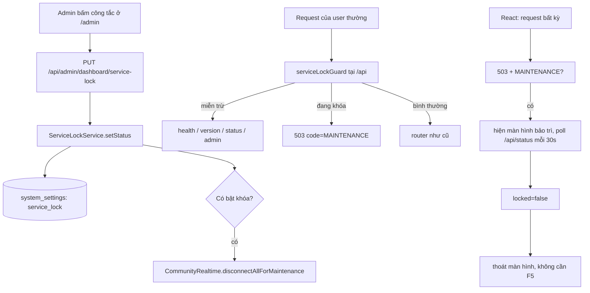

# Spec — Công tắc khóa dịch vụ để bảo trì (service lock)

**Ngày:** 2026-10-12
**Trạng thái:** chờ duyệt (chưa implement)
**Phạm vi:** chỉ tính năng công tắc bảo trì. Đợt dựng lại server 2 tầng **đang gác**, xem Phụ lục A.

---

## 1. Bối cảnh

EC2 cũ đã bị xoá (account AWS `143784554304` hiện trống: 0 instance, 0 snapshot, 0 volume), nên website chưa có chỗ chạy. Việc dựng lại server (fe + bdu-hub + db) là một đợt riêng, đã được thiết kế xong nhưng **tạm gác**.

Chủ sở hữu chọn làm **công tắc bảo trì trước**, vì:
- khi bảo trì DB hoặc deploy, người dùng cần thấy thông báo rõ ràng thay vì lỗi khó hiểu;
- không muốn phải sửa code hay restart server mỗi lần khóa/mở dịch vụ.

Điều kiện chấp nhận đã biết trước: chưa có server, nên đợt này **chỉ phát triển và nghiệm thu được ở local**; giá trị thật của công tắc chỉ dùng được sau khi đợt dựng server hoàn tất.

---

## 2. Ý định đã xác nhận

| | |
| :--- | :--- |
| **Kết quả** | Chủ sở hữu bật một công tắc trong `/admin` là **toàn bộ website khóa ngay**, người dùng thấy thông báo "dịch vụ đang tạm khóa để bảo trì"; tắt công tắc là site trở lại bình thường. |
| **Ai dùng** | Chủ sở hữu/vận hành (qua `/admin`). Người dùng cuối chỉ *thấy* màn hình bảo trì. |
| **Vì sao bây giờ** | Sắp dựng lại server và sẽ phải bảo trì/migrate DB; cần công cụ khóa site không phụ thuộc sửa code. |
| **Thành công** | Bật ở `/admin` → trong ~1 giây mọi API của người dùng thường trả 503 kèm mã `MAINTENANCE`, tab đang mở tự hiện màn hình bảo trì; admin vẫn vào được; tắt là tự hết (tối đa 30 giây), không cần F5, không cần restart. |
| **Ràng buộc** | Không sửa quy tắc "thứ tự đăng ký route là hành vi routing"; không thêm migration; phải tái dùng hạ tầng `system_settings` + `requireAdmin` đã có; `deploy.sh` phải không bị ảnh hưởng (healthcheck). |
| **Ngoài phạm vi** | Khóa theo từng nhóm dịch vụ; hẹn giờ tự khóa/mở; trang bảo trì phía reverse proxy; thông báo cho người đang online; đổi UI ngoài màn hình bảo trì. |

---

## 3. Thiết kế phía server

### 3.1. Lưu trạng thái (không cần migration)

Dùng bảng `system_settings` (đã có từ migration 053: `key TEXT PRIMARY KEY, value JSONB NOT NULL, updated_at TIMESTAMPTZ, updated_by TEXT`).

- Key: `service_lock`
- Value: **chỉ 3 trường**

```json
{ "locked": true,
  "title": "Dịch vụ đang tạm khóa để bảo trì",
  "message": "Hệ thống đang bảo trì, vui lòng quay lại sau." }
```

Không lưu thời gian mở lại (`eta`) ở bất kỳ đâu — chủ sở hữu đã quyết định không hiển thị giờ mở lại, và không gửi `Retry-After` vì không có con số thời gian trung thực để gửi.

`updated_at`/`updated_by` dùng cột có sẵn của bảng, không nhét lại vào JSON.

### 3.2. `src/services/service-lock.service.js` (file mới)

```js
export const SERVICE_LOCK_SETTING_KEY = 'service_lock';

// Dùng khi chưa từng có bản ghi, và khi admin bật khóa mà không nhập nội dung.
export const DEFAULT_TITLE = 'Dịch vụ đang tạm khóa để bảo trì';
export const DEFAULT_MESSAGE = 'Hệ thống đang bảo trì, vui lòng quay lại sau.';

export const ServiceLockService = {
  async getStatus(),          // đọc qua SystemSettingsService, fail-open, trả shape chuẩn hoá
  async setStatus(payload, updatedBy)  // validate + ghi qua SystemSettingsService, trả record mới
};
```

- `getStatus()` bọc `try/catch`: **lỗi DB ⇒ trả `{ locked: false }`** (fail-open). Lý do: không biến một sự cố DB thành sự cố toàn site, và không tạo thêm một đường làm site chết.
- `setStatus()` chỉ nhận `locked` (boolean, bắt buộc), `title` (string ≤ 120 ký tự), `message` (string ≤ 500 ký tự); trim; sai ⇒ ném lỗi `status: 400`. Giới hạn độ dài là bắt buộc vì `message`/`title` sẽ được trả ở một endpoint công khai.
- Service là **nơi duy nhất** biết shape, default và chính sách fail-open.

### 3.3. `src/utils/service-lock-guard.js` (file mới)

Export `createServiceLockGuard({ getStatus })` trả về middleware Express. Đặt ở `src/utils/` theo đúng tiền lệ `src/utils/request-context.js` (middleware cấp app đang nằm ở đó).

Middleware:
1. Bỏ qua nếu `getStatus()` trả `locked: false` (hoặc lỗi → coi như không khóa).
2. Nếu đang khóa và đường dẫn **không** thuộc danh sách miễn trừ → trả `503`:

```json
{ "result": false, "code": "MAINTENANCE",
  "title": "...", "message": "..." }
```

Danh sách miễn trừ (so trên `req.path`, tức phần **đã bị cắt** tiền tố `/api` vì middleware được mount tại `/api`):

| Đường dẫn (sau khi cắt `/api`) | Vì sao miễn trừ |
| :--- | :--- |
| `/health` | `deploy/deploy.sh` poll endpoint này để biết app sống. Chặn nó ⇒ deploy tưởng app chết và tự rollback. |
| `/version` | Banner "có bản mới" của client và `/api/version` dùng để đối chiếu build id. |
| `/status` | Endpoint công khai mới để client biết trạng thái khóa (mục 3.5). |
| tiền tố `/admin/dashboard` | Đã tự bảo vệ bằng `requireAdmin`; đồng thời chứa `/admin/dashboard/login` nên admin vẫn đăng nhập được trong lúc khóa. |

Mọi route `/api/*` còn lại — kể cả `/api/queue-status`, `/api/login`, các route automation, game, cộng đồng — đều bị chặn khi đang khóa.

Ghi chú kỹ thuật bắt buộc: khi mount tại `/api`, Express **cắt tiền tố** khỏi `req.url`/`req.path` trong phạm vi middleware đó. Vì vậy so sánh phải dùng `/health` chứ không phải `/api/health`. Nếu dùng sai, mọi request đều bị coi là không miễn trừ và site tự khóa chính mình — đây là lỗi phải có test chặn.

### 3.4. Chèn vào `src/app.js`

Thêm đúng một dòng ngay **trước** dòng 185 (`app.use('/api', apiRoutes)`), tức là **sau** toàn bộ mount static (dòng 60–170):

```js
app.use('/api', createServiceLockGuard({ getStatus: () => ServiceLockService.getStatus() }));
app.use('/api', apiRoutes);   // dòng 185, không đổi
```

Vì sao vị trí này:
- **Sau** mount static ⇒ `dist/client`, `/app-assets`, `/public`, `/games`, `/admin` vẫn phục vụ bình thường, nhờ đó React tải được và tự hiện màn hình bảo trì (không cần server render trang bảo trì).
- **Trước** router ⇒ không phải chạm `src/routes/api.routes.js`, nên không vi phạm quy tắc "thứ tự gọi `register*Routes` là hành vi routing" (quy tắc 3.2 trong `docs/architecture.md`, có `scripts/verify-route-order.mjs` canh).

### 3.5. `GET /api/status` (công khai)

Thêm vào `src/routes/meta.routes.js` (nhóm "Health, queue status, version" — đúng chỗ):

```
GET /api/status  →  200
{ "result": true, "data": { "locked": false, "title": "...", "message": "..." } }
```

- Không trả `updated_by`, `updated_at`.
- `title`/`message` là công khai (đằng nào cũng hiển thị cho người dùng). Đây là chủ ý, không phải rò rỉ.

### 3.6. WebSocket (`src/services/community-realtime.service.js`)

- **Chặn kết nối mới:** trong `httpServer.on('upgrade', ...)` (dòng 180), chèn bước kiểm tra trạng thái **sau** kiểm tra origin (dòng 189) và **trước** `this.wss.handleUpgrade(...)` (dòng 194). Nếu đang khóa: ghi `HTTP/1.1 503 Service Unavailable` + `Connection: close` rồi `socket.destroy()`. Handler phải `async` và có `try/catch` để không tạo unhandled rejection.
- **Đóng kết nối đang mở:** thêm method `disconnectAllForMaintenance()` trên gateway: duyệt `this.clients` (cùng kiểu vòng lặp với `close()` ở dòng 1012) và `client.ws.close(1001, 'Dich vu dang bao tri')`.
- Method này được gọi từ controller admin **sau khi** ghi `locked: true` thành công.
- **Không** đóng SSE đang mở (`/api/tool-runs/:runId/events`, `/api/survey/stream`): chặn được request *mới* qua middleware là đủ; luồng đang chạy sẽ tự kết thúc theo tiến trình nghiệp vụ. Ghi nhận đây là giới hạn đã biết.

### 3.7. Admin API

Thêm vào `src/routes/admin.routes.js` (sau `router.use('/admin/dashboard', requireAdmin)` để thừa hưởng `requireAdmin`) và 2 method trong `src/modules/admin/admin-dashboard.controller.js`, mô phỏng đúng cặp `ranking-sync` đã có (dòng 75, 85, 415):

| Method | Path | Request | Response |
| :--- | :--- | :--- | :--- |
| `GET` | `/api/admin/dashboard/service-lock` | — | `{ result:true, data:{ locked, title, message, updated_at, updated_by } }` |
| `PUT` | `/api/admin/dashboard/service-lock` | `{ locked, title?, message? }` | như GET (record sau khi ghi) |

- Dùng **`PUT`** cho khớp convention của `ranking-sync` (endpoint hiện có dùng `PUT`, không phải `POST`).
- `updatedBy = req.identityAdminMssv || 'ADMIN_KEY'` (giá trị `ADMIN_KEY` là cách `requireAdmin` đánh dấu khi xác thực bằng header key; không bao giờ ghi giá trị key vào log).
- Khi `locked: true` ghi thành công ⇒ gọi `CommunityRealtime.disconnectAllForMaintenance()`.
- Lỗi validate từ service ⇒ `400`; lỗi khác ⇒ `500`.

### 3.8. Luồng



---

## 4. Thiết kế phía client

### 4.1. `client/src/api/http.js` (sửa)

Lặp lại đúng khuôn `session_expired` đã có trong file (dòng 15–19: `window.dispatchEvent(new CustomEvent('bdu:session_expired'))`):

- thêm `MaintenanceError extends ApiError` với `status: 503`, `code: 'MAINTENANCE'`;
- thêm `notifyMaintenance(details)` phát event `bdu:maintenance`;
- trong `request()`, nhánh `response.status === 503 && data?.code === 'MAINTENANCE'` đặt **trước** nhánh `!response.ok` (dòng 63), nếu không nó bị bọc thành `ApiError` thường và mất `title`/`message`.

### 4.2. `client/src/app/MaintenanceGate.jsx` (file mới)

- Nghe event `bdu:maintenance` → chuyển sang trạng thái khóa.
- Khi mount: gọi một lần `GET /api/status` (không cần token) để bắt đúng trường hợp người dùng mở tab mới trong lúc đang khóa.
- Khi **đang khóa**: poll `/api/status` mỗi 30 giây → tự phát hiện mở lại.
- Khi **bình thường**: **không** có request nền nào.
- Render màn hình **toàn trang** đè mọi route: `title`, `message`, nút "Thử lại" (gọi lại `/api/status` ngay).
- Đặt tại `client/src/app/App.jsx`, bọc quanh `<AppRoutes />` bên trong `<AppProviders>`:
  `<AppProviders><MaintenanceGate><AppRoutes /></MaintenanceGate></AppProviders>`.
  Như vậy **không** phải thêm `<Route>` nào ⇒ không sửa `client/src/app/routes.jsx`, tránh rủi ro cho `tests/frontend/routing-contract.test.js`.

### 4.3. Admin UI — site tĩnh `public/admin/`

- `public/admin/index.html`: thêm card "Khóa dịch vụ" trong tab System (`data-tab="system"`), cùng khu vực với card ranking hiện có.
- `public/admin/admin.js`: thêm `state.serviceLock`, `renderServiceLock()`, ghép request `api('/api/admin/dashboard/service-lock')` vào `Promise.all` sẵn có (dòng ~414); toggle + 2 ô nhập (tiêu đề, nội dung) + nút lưu; dùng `api(url, { method: 'PUT', ... })`; phản hồi bằng `showToast` như các thao tác khác.
- **Bắt buộc có hộp thoại xác nhận khi bật khóa** (hành động ảnh hưởng toàn site). Tắt khóa thì không cần xác nhận.
- `public/admin/admin.css`: style theo card có sẵn.
- Không cần sửa `public/admin-tool.html` (site legacy, ngoài phạm vi).

---

## 5. Xử lý lỗi và các trường hợp biên

| Tình huống | Hành vi |
| :--- | :--- |
| DB lỗi / chưa cấu hình `DATABASE_URL` | **Fail-open**: phục vụ bình thường như khi không khóa. |
| `deploy.sh` đang chạy healthcheck trong lúc site bị khóa | `/api/health` miễn trừ ⇒ deploy vẫn xanh. |
| Admin đăng nhập trong lúc khóa | `/api/admin/dashboard/login` nằm trong tiền tố miễn trừ ⇒ vào được. |
| Admin dùng `x-admin-key` | Đi qua tiền tố `/admin/dashboard` miễn trừ, không phụ thuộc đăng nhập. |
| Hai admin cùng ghi | Last-write-wins; `updated_by`/`updated_at` cho biết ai ghi sau. |
| Đổi trạng thái có hiệu lực sau bao lâu | Ghi ở cùng process ⇒ `SystemSettingsService` xoá cache ngay ⇒ ~tức thời. Chỉ khi chạy nhiều replica mới trễ tối đa 30 giây; hệ thống hiện cố định 1 replica (`docker-compose.yml`: `deploy.replicas: 1`). |
| Tab người dùng đang mở khi bật khóa | Request kế tiếp dính 503 ⇒ hiện màn hình bảo trì. |
| Tab đang mở khi tắt khóa | Tự hết trong tối đa 30 giây nhờ poll; bấm "Thử lại" thì ngay lập tức. |
| WS đang mở khi bật khóa | Bị đóng mã `1001` kèm lý do; client tự reconnect theo backoff như khi mất mạng, nhưng sẽ bị từ chối cho tới khi mở lại. |
| SSE đang mở khi bật khóa | Không bị đóng (giới hạn đã biết, ghi ở mục 3.6). |
| Gọi `/api/status` lỗi (mất mạng) | Giữ nguyên trạng thái đang hiển thị; không tự thoát màn hình bảo trì chỉ vì một lần gọi lỗi. |
| Bấm nhầm khóa | Có hộp thoại xác nhận; mở lại bằng chính công tắc đó, không cần deploy. |

---

## 6. Kiểm thử

| File | Loại | Chứng minh điều gì |
| :--- | :--- | :--- |
| `tests/test-service-lock.js` | node, không cần DB | `getStatus()` fail-open khi lỗi DB; middleware chặn đúng/cho qua đúng theo danh sách miễn trừ dùng **path đã cắt tiền tố** (test chống đúng lỗi ở mục 3.3); payload 503 có `code:'MAINTENANCE'`; `setStatus` từ chối `locked` không phải boolean và `title`/`message` quá dài. |
| `tests/frontend/maintenance-gate.test.jsx` | vitest + jsdom | 503 `MAINTENANCE` ⇒ hiện màn hình bảo trì; `/api/status` trả `locked:false` ⇒ app bình thường; sau khi mở khóa, "Thử lại" ⇒ thoát màn hình. |

- Cả hai file **phải** được khai vào `scripts/test-manifest.mjs` — repo có `tests/test-manifest.test.mjs` bắt buộc mọi file test phải được phân loại.
- Chạy trước khi báo xong: `npm run lint:frontend`, vitest, `tests/test-service-lock.js`.

---

## 7. Tiêu chí nghiệm thu

1. Chưa khóa: hành vi y hệt hiện tại, và **không** có request nền mới nào từ client.
2. Bật khóa ở `/admin` ⇒ trong ~1 giây:
   - API của user thường (ví dụ `GET /api/profile`) trả `503` + `{ result:false, code:'MAINTENANCE' }`;
   - `/api/health`, `/api/version`, `/api/status` vẫn `200`;
   - tab đang mở hiện màn hình bảo trì;
   - mở WS mới bị từ chối.
3. Trong lúc khóa: `x-admin-key` hoặc tài khoản owner/identity_admin vẫn gọi được `/api/admin/dashboard/*`.
4. Tắt khóa ⇒ màn hình biến mất trong tối đa 30 giây (không cần F5), API trở lại bình thường.
5. `GET /api/status` **không** chứa `updated_by`.
6. `npm run lint:frontend` + vitest + `tests/test-service-lock.js` xanh.
7. Sau khi thêm 3 route mới, `node scripts/verify-route-order.mjs` xanh **sau khi** khai 3 route đó vào `ROUTES_ADDED_AFTER_SPLIT` (xem mục 8).

---

## 8. Rủi ro và cách giảm thiểu

| Rủi ro | Giảm thiểu |
| :--- | :--- |
| Cửa chặn đặt sai chỗ ⇒ site tự khóa chính mình, kể cả `/api/health` | Có test riêng cho danh sách miễn trừ, và test dùng path đã cắt tiền tố. |
| Thêm route mới mà quên khai báo vào guard thứ tự route | `scripts/verify-route-order.mjs` sẽ báo lệch. **Hệ quả đã biết trước:** đợt này thêm 3 route (`/api/status`, `GET`+`PUT /api/admin/dashboard/service-lock`), plan phải có task khai 3 route này vào `ROUTES_ADDED_AFTER_SPLIT` trong script đó. (`scripts/verify-controller-split.mjs` không ảnh hưởng: script cố ý bỏ qua `admin-dashboard.controller.js`.) |
| Khóa site rồi không vào lại được `/admin` | Tiền tố `/admin/dashboard` miễn trừ, gồm cả login; và `x-admin-key` hoạt động độc lập với đăng nhập. |
| Cửa chặn thêm một truy vấn DB cho mỗi request ⇒ chậm | Đọc qua `SystemSettingsService` (cache 30 giây), ghi thì xoá cache. Chi phí ~0. |
| Nội dung thông báo bị lợi dụng (endpoint công khai) | Chỉ admin ghi được; `title` ≤ 120 và `message` ≤ 500 ký tự, trim, validate ở service. |
| Bấm nhầm làm sập site | Hộp thoại xác nhận khi bật khóa; mở lại không cần deploy. |

---

## 9. Cố ý KHÔNG làm (YAGNI)

- Không khóa theo từng nhóm dịch vụ — một công tắc tổng là đủ cho nhu cầu đã nêu.
- Không hẹn giờ tự khóa/mở.
- Không hiển thị giờ mở lại (`eta`), không gửi `Retry-After` (không có số liệu trung thực để gửi).
- Không làm trang bảo trì phía reverse proxy (khác vấn đề: "BE chết", không phải "chủ động khóa").
- Không thêm migration (bảng `system_settings` đã có).
- Không thông báo chủ động cho người đang online (không có kênh push ngoài WebSocket, mà WebSocket đằng nào cũng bị đóng).

---

## 10. Danh sách file sẽ chạm

| File | Loại |
| :--- | :--- |
| `src/services/service-lock.service.js` | mới |
| `src/utils/service-lock-guard.js` | mới |
| `src/app.js` | sửa 1 dòng (chèn trước dòng 185) |
| `src/routes/meta.routes.js` | sửa (thêm `/status`) |
| `src/routes/admin.routes.js` | sửa (thêm `GET`/`PUT service-lock`) |
| `src/modules/admin/admin-dashboard.controller.js` | sửa (thêm 2 method) |
| `src/services/community-realtime.service.js` | sửa (chặn upgrade + `disconnectAllForMaintenance`) |
| `client/src/api/http.js` | sửa (nhánh 503 + event) |
| `client/src/app/MaintenanceGate.jsx` | mới |
| `client/src/app/App.jsx` | sửa (bọc gate quanh `AppRoutes`) |
| `public/admin/index.html`, `public/admin/admin.js`, `public/admin/admin.css` | sửa (card + toggle) |
| `tests/test-service-lock.js`, `tests/frontend/maintenance-gate.test.jsx` | mới |
| `scripts/test-manifest.mjs` | sửa (khai 2 test mới) |
| `scripts/verify-route-order.mjs` | sửa (khai 3 route mới) |

Không có thay đổi nào trong `migrations/`.

---

## Phụ lục A — Đợt dựng server đang gác (quyết định đã chốt, không mất)

> **Đợt dựng server đã được triển khai thành
> [`2026-10-13-dung-server-aws-design.md`](2026-10-13-dung-server-aws-design.md)**
> (kèm các điểm điều chỉnh so với phụ lục này).

Ghi lại để spec của đợt đó không phải hỏi lại:

- **2 tầng:** `fe` (Caddy 2-alpine: `file_server` cho `dist/client`, `reverse_proxy` `/api/*` và `/ws/*` → `bdu-hub:3000`, tự xin cert Let's Encrypt) + `db` (postgres:16-alpine + named volume). Giữ tên service `bdu-hub` cho tầng BE (tên này xuất hiện ở ~30 chỗ trong `deploy.sh`, 2 runbook, compose).
- **EC2:** mới ở `ap-southeast-1`, **t3a.small** (2 vCPU/2 GB) + 20 GB gp3 + swap 2 GB, Elastic IP; Cloudflare proxy ON + SSL **Full (strict)**; security group chỉ mở 22 (IP của chủ sở hữu) + 80 + 443, không mở 3000/5432; dùng default VPC (tránh NAT Gateway ~$32/tháng).
- **Chi phí:** ~$0.72/ngày (~$22/tháng) cho cấu hình trên, dựa trên giá thật lấy từ AWS Pricing API (`t3a.small` $0.0236/giờ, gp3 $0.096/GB-tháng, IPv4 $0.005/giờ, egress $0.12/GB cho 10 TB đầu).
- **Tắt để đủ RAM:** `FB_IMPORT_ENABLED=false` (tài khoản Facebook cũng đã mất cùng `.env` cũ), bật lại Chromium-heavy job chỉ khi cần. WordFmt **giữ nguyên** (tiến trình .NET gọi theo yêu cầu, tắt nó không giảm được cấu hình máy; gỡ khỏi image chỉ tiết kiệm ~$0.02/tháng mà phải sửa Dockerfile).
- **Dữ liệu:** restore `data/vps_sync_20260919.sql` (85 MB, plain SQL, **không** dùng được `npm run db:restore` vì script đó cần file custom-format + manifest) → tạo DB rác `bdu_fresh` migrate 001→056 → so fingerprint để chốt mốc (bằng chứng hiện có: dump có 042 + 043, thiếu 044/045/047/052–056 ⇒ mốc nằm giữa 043 và 044) → baseline → migrate → fingerprint(`bdu_hub`) phải trùng khít fingerprint(`bdu_fresh`) mới cho app chạy.
- **`.env`:** khoảng 70 biến; nhóm đã có ở local (`POSTGRES_*`, `CDS_*`, `DISCORD_*`, `PUBLIC_APP_URL`, `WS_*`) và nhóm phải cấp lại (`SYSTEM_OWNER_MSSV`, `R2_*`, `DISCORD_BOT_TOKEN`, `SMTP_*`, `ADMIN_DASHBOARD_KEY`, …). `NOTIFICATION_ENCRYPTION_KEY` **sinh mới được**: nó chỉ mã hoá `bdu_token_vault` (token phiên BDU) và `training_cds_credentials`, mất key cũ ⇒ người dùng đăng nhập lại, không mất dữ liệu nghiệp vụ. Media trong R2 vẫn sống vì URL được sinh lúc đọc từ biến môi trường, DB chỉ lưu key.
- **Build:** GitHub Actions → GHCR → EC2 `docker compose pull` (t3a.small không đủ RAM để build image có Chromium + .NET); tag theo `<sha>` để rollback bằng tag.
- **Bootstrap tách khỏi deploy:** `deploy/bootstrap-server.sh` chạy một lần (swap, Docker, clone, `.env`, restore+build DB, `up -d`); `deploy/deploy.sh` các lần sau không bao giờ chạm file dump.
- **Không đổi code ứng dụng** trong đợt đó (đúng nghĩa đóng gói lại).
- **Nghiệm thu đợt đó:** compose all healthy · `/api/health` + `/api/version` khớp SHA · HTTP→HTTPS + cert hợp lệ · WS `wss://` kết nối được · đăng nhập BDU thật · đếm `students`/`community_posts` khớp dump + fingerprint trùng · ảnh cũ load từ R2 · backup tạo object trên R2 + `db:backup:verify` xanh · từ Internet cổng 3000/5432 đóng · thử rollback 1 lần.
